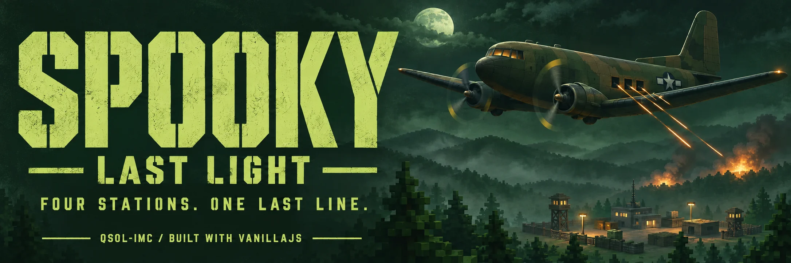
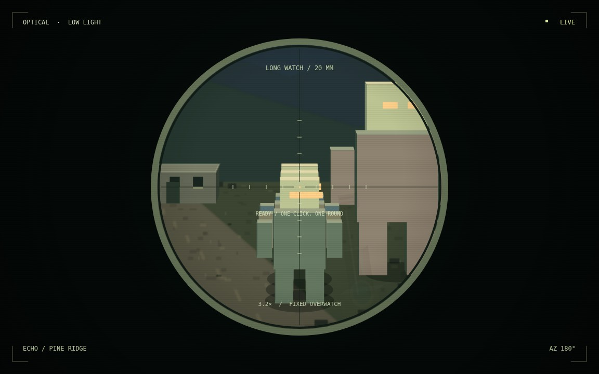
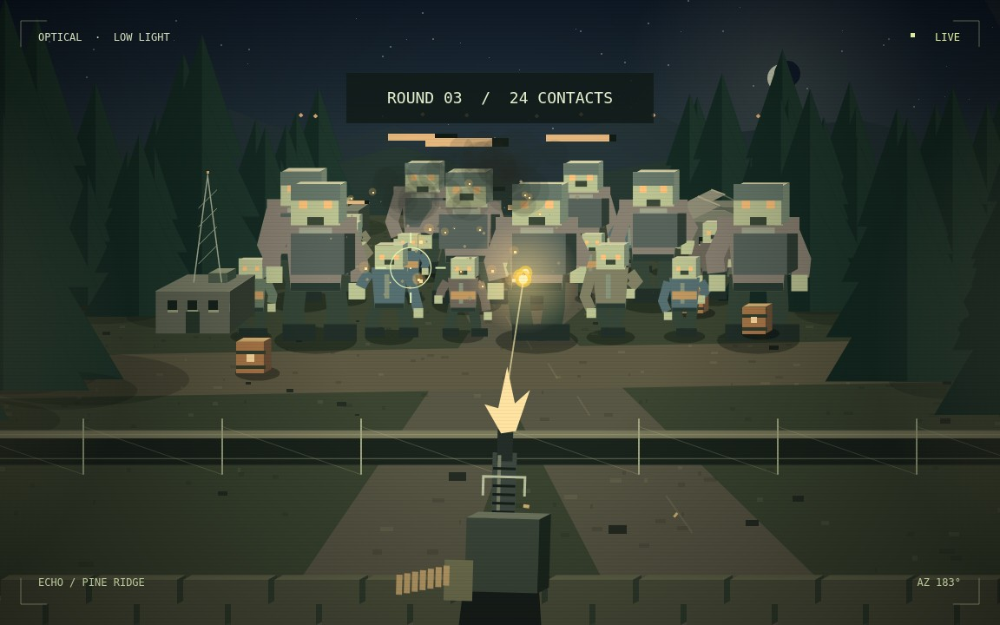

# SPOOKY — Last Light

**Four stations. One last line.**

An original, offline-first horde defence game built with [VANILLAJS](https://github.com/QSOLKCB/VANILLAJS). Command an AC-130 gunship, move to the artillery battery, take the M2 at the wire, then man a fixed 20 mm bolt-action sniper rifle. The next wave is bigger. Your upgrades stay with you.

[Play on GitHub Pages](https://qsolkcb.github.io/Spooky/) · [Field manual](docs/GAMEPLAY.md) · [Engineering and provenance](docs/ARCHITECTURE.md)

## Why Spooky?

The name honours the **Douglas AC-47 Spooky**, the C-47-based aircraft that pioneered the US Air Force's operational side-firing gunship role before the AC-130. The banner pays tribute to that namesake; the game follows the later AC-130 into an original night-defence scenario.

Read about the [AC-47 Spooky](https://en.wikipedia.org/wiki/Douglas_AC-47_Spooky) and the National Museum of the US Air Force's [Gunship I: Spooky](https://www.nationalmuseum.af.mil/Visit/Museum-Exhibits/Fact-Sheets/Display/Article/195865/gunship-i-spooky/). The banner is original generated concept art; [its prompt and provenance](docs/BANNER.md) are included.

## The operation

| Round | Station | Your job |
| --- | --- | --- |
| 1, 5, 9… | AC-130 / Spectre orbit | Thermal overhead view. Switch between a 25 mm Gatling, 40 mm cannon and 105 mm howitzer. |
| 2, 6, 10… | Artillery / Thunder battery | Place delayed high-explosive impacts ahead of moving groups. |
| 3, 7, 11… | Infantry / Last line | Work the M2 .50 cal from ground level. Manage the belt and barrel heat. |
| 4, 8, 12… | Sniper / Long watch | Scope in with the 20 mm rifle. Pick heads, time the bolt and line up collaterals. |

Clear a round and choose **one of three upgrades** for the station you just used. Damage, blast radius, firing/reload speed, ammunition capacity and cooling upgrades persist across rotations. Field repairs restore the shared outpost instead. Each gunship upgrade applies to all three aircraft weapons.

The outpost automatically recovers 8 integrity between rounds; the incoming station is resupplied. Runners enter from round 2 and armoured bulwarks from round 3. There is no final wave: survive until the perimeter falls.

## Long watch — the fourth station

Adapted from [QUICKSCOPER](https://github.com/QSOLKCB/QUICKSCOPER), the **fixed 20 mm anti-materiel rifle** follows the M2. A 3.2× scope settles in 0.15 seconds; one click fires one round and cycles the bolt. Heads take 2.5× damage. Quickscope kills earn bonus points; you can also wait for several targets to line up: a round can penetrate three enemies, retaining 70% damage at each hit. Buildings stop the shot.

The rifle has its own upgrade ranks: damage, bolt/reload speed, magazine capacity, extra penetrations and better retained damage. Its sight, trigger buffer, recoil and chambering sounds follow simulation ticks. Hip fire uses seeded dispersion. A separate SCOPE button preserves independent aiming and firing fingers on touchscreens.



[Controls, source adaptation and validation](docs/SNIPER_STATION.md).

## Make the heavy gun count

The gunship weapons have distinct jobs. The **40 mm now has the former 105 mm's damage and radius**. The **105 mm** delivers almost three times that damage across **5.6× the nominal area**, with a much larger fireball, expanding ground shockwave, lingering smoke, extra debris and a deeper report.

| Weapon | Base damage | Blast radius, game units | Role |
| --- | ---: | ---: | --- |
| 25 mm | 30 | 2.6 | Fast precision fire and headshots |
| 40 mm | 135 | 11 | Rapid cluster-clearing splash |
| 105 mm | 400 | 26 | Deliberate, massive area-clearing strikes |

Damage outlines now project the actual world-space footprint. The centre crosshair stays small enough to aim accurately. [Balance rationale, historical sources and comparison captures](docs/GUNSHIP_BALANCE.md).

## Last Light March

An original **120 BPM military march**, composed and synthesised with VANILLAJS: marching bass drums, accented field snares, turnaround rolls, brass-style calls and low horn harmonies. Its 16 bars form a 32-second loop, with four station arrangements:

- **Spectre march:** low-register gunship brass and restrained ghost strokes.
- **Thunder march:** deeper field drums and a full brass lead for artillery.
- **Last line march:** brighter infantry calls and busier snare cadences.
- **Long watch march:** a quieter, high-register fife-like lead over the field cadence.

[Listen to an eight-second infantry preview (WAV)](docs/assets/last-light-march-preview.wav). In the game, open the field manual, select an arrangement and **DOWNLOAD MARCH · WAV** to export the complete track. Music and FX have independent switches.

The score uses four bounded integer-PCM lanes and fixed note/noise seeds. Identical station scores produce identical WAV bytes; arbitrary render chunks match uninterrupted rendering. Playback follows the simulation tick and resumes at the correct musical position after a pause. Everything is generated locally and works offline.

## Included

- Four pixel/voxel views with articulated characters, armoured bulwarks, shaded buildings, trees, trenches, searchlights and rotating lighting palettes.
- Gravity-driven shells and bouncing debris, blast knockback, persistent craters, fuel-drum chains, headshot bonuses, tracers and weapon recoil.
- Enemies steer around solid buildings and separate from nearby horde members.
- Increasing hordes, three enemy classes, three difficulty settings, chain bonuses and separate local best scores per difficulty.
- Six upgrade choices, deterministic three-card drafts, persistent station builds and independent gunship ammunition/reload state.
- Four deterministic arrangements of Last Light March, layered weapon reports, stereo positioning, bounded voices and selectable full-loop WAV export.
- **Fit window, Fullscreen and Windowed page**, brought across from [Outruin PR #4](https://github.com/QSOLKCB/Outruin/pull/4). The full battlefield, HUD and touch controls fit within the available window.
- Mouse, keyboard, touch and standard gamepad controls. Automatic pause on focus or display changes and explicit resume.
- Offline caching after the first complete visit. No account, backend, CDN, runtime package install or downloaded art.
- Pure fixed-tick combat, seeded encounters, executable tests and byte-verified VANILLAJS provenance.



## Controls

| Input | Action |
| --- | --- |
| Pointer / WASD / arrows | Aim |
| Hold left mouse / Space | Fire; sniper requires a fresh click/press per round |
| Right mouse / Shift / left trigger | Hold to scope with the rifle |
| Q / SCOPE button | Toggle rifle scope |
| 1 / 2 / 3 | Switch gunship weapon; select an upgrade when the draft is open |
| R | Reload |
| P / Esc | Pause or resume |
| Touch | Drag the battlefield to aim; hold the separate FIRE button; tap once per rifle shot |
| Standard gamepad | Left stick aims; right trigger or A fires; left trigger scopes; X reloads; shoulders switch weapon; Start pauses |

Use the mouse on the creature's visible body, or aim ahead on the ground to place a blast. Head hits with the 25 mm or M2 deal 1.65× damage to the selected creature. Orange fuel drums can clear a group in a chain reaction. There is no pointer lock. Leaving the tab clears held inputs and pauses the run.

Use **DISPLAY** in the header to change view modes. **Fit window** is the default; **Fullscreen** requests native browser fullscreen; **Windowed page** restores scrolling. Leaving fullscreen restores the saved windowed choice. Unsupported or denied fullscreen falls back to Fit window. Changing modes pauses combat and clears held inputs; resume explicitly when ready. Short menus scroll within the battlefield.

## Run locally

Serve the repository with a small local server:

```sh
uv run --no-project python -m http.server 8000
```

Then open `http://localhost:8000`. Python's built-in `python3 -m http.server 8000` also works. Native ES modules need HTTP; double-clicking `index.html` is not supported.

To create a clean static distribution with Node 24 or newer:

```sh
node scripts/build.mjs
```

Serve `dist/`. The build uses only Node's standard library and copies an explicit public allowlist. No bundler is involved. The checked-in service worker also supports serving the repository root.

## Verify

The fourth-station update passes **48 pure tests and 20 packaged Chromium scenarios**, covering rifle geometry, scope/trigger timing, collaterals and four-station progression. [Current validation and source-bound receipts](docs/SNIPER_STATION.md#validation).

```sh
node scripts/check.mjs
node --test tests/*.test.js
node scripts/build.mjs
```

Browser verification uses Playwright as a **development-only** tool. CI installs Playwright 1.56.0 in a temporary directory, plays all four stations through real DOM input handlers, and uploads screenshots plus `test-results/browser.json`, including failures. If Playwright is already installed:

```sh
PLAYWRIGHT_MODULE=/absolute/path/to/playwright node tests/browser.mjs
```

`CHROMIUM_PATH` optionally selects an installed Chromium binary. Tests cover complete rounds, collisions, ballistics, fuel chains, headshots, draft choices, reload and heat, pause/focus cancellation, projected body picking, keyboard toolbar focus, mobile multitouch, native fullscreen, denied fullscreen, short-screen layout, four WAV exports, audio failure, restart and offline operation under `/Spooky/`. See the [upgrade validation record](docs/VALIDATION.md) for the executed scope.

CI runs on every PR and main-branch push. A successful main run publishes its verified `dist/` artifact to Pages; select **GitHub Actions** as the Pages source in repository settings if the repository still uses branch-based Pages. Implementation is delivered through a PR; merging and tagging remain owner actions.

## Build your own night

Game data lives in `js/content.js`; combat and wave rules in `js/sim.js`; shared scenery in `js/world.js`; motion in `js/physics.js`; rifle geometry and scope rules in `js/sniper.js`; the four views in `js/render.js`; soundtrack and effects in `js/audio.js`, including the editable `MARCH_THEME` note sequence. These are ordinary inspectable ES modules. See [the architecture notes](docs/ARCHITECTURE.md) before changing simulation or vendor files. This release supports source edits, not an in-game mod-pack editor.

Apache-2.0. Copyright 2026 Trent Slade / QSOL-IMC and contributors. Upstream licences and notices are preserved. An original arcade game, with no Call of Duty assets, music or code; weapon names are fictional gameplay context, not real weapon training.
