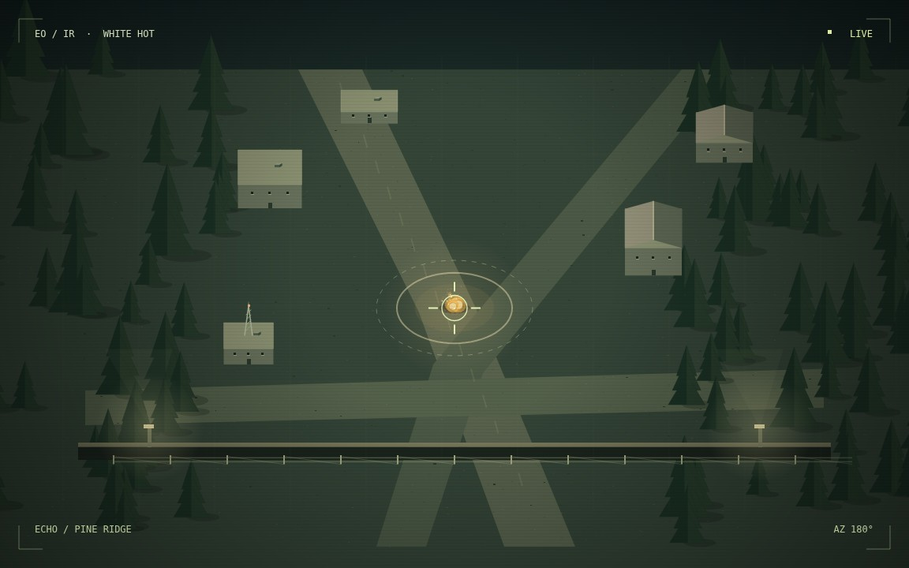
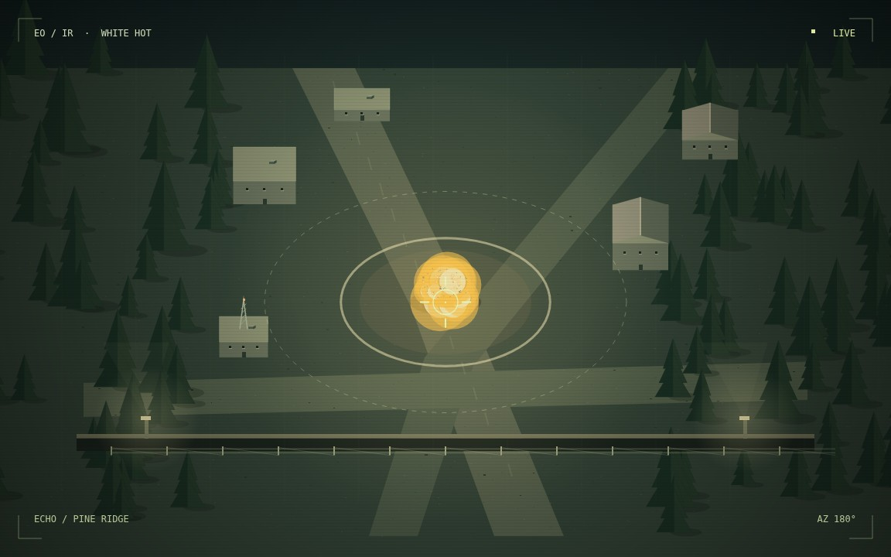

# Gunship weight and Last Light March

This update starts from merged Spooky `6b1c02f84b4c1751a9925f5db36036a3b8daac48`.

## Weapon roles

The slow 105 mm needed a substantial payoff. The 40 mm inherits the previous 105 mm's base damage and radius, while the 105 mm becomes a much wider area-clearing weapon.

| Parameter | 40 mm before | 40 mm now | 105 mm before | 105 mm now |
| --- | ---: | ---: | ---: | ---: |
| Centre damage, health points | 68 | 135 | 135 | 400 |
| Nominal blast radius, game units | 5.8 | 11 | 11 | 26 |
| Firing interval, simulation ticks | 26 | 26 | 100 | 100 |
| Flight time, simulation ticks | 22 | 22 | 40 | 40 |
| Magazine | 16 | 16 | 5 | 5 |

The new 105 mm has `26 / 11 ≈ 2.36` times the radius and `(26 / 11)² ≈ 5.59` times the nominal circular area of the 40 mm. Damage retains its existing radial falloff and creature-size tolerance. The available area is clipped by the battlefield boundary near its edges. Upgrades continue to scale the appropriate base values.

A dedicated 105 mm profile supplies a longer-lived fireball/smoke plume, 48 launch particles versus 20 for a standard heavy impact, a larger crater, stronger survivor impulse, and separate firing/impact sound recipes. Particle and voice caps remain enforced. Reduced motion suppresses impact-light pulses and recoil. Landing/aim/shockwave guides project the actual world-space circle; the small centre crosshair stays usable.

| Same seed, aim and impact age | Capture |
| --- | --- |
| 40 mm |  |
| 105 mm |  |

## Historical basis and game scale

The US Air Force's *Development and Employment of Fixed-Wing Gunships 1962–1972*, printed page 173, describes the 105 mm addition as a major increase in explosive payload over the 40 mm. That historical distinction informs the two gameplay roles. [Official Air Force history, hosted by the Department of Defense](https://media.defense.gov/2010/May/26/2001330293/-1/-1/0/fixedwinggunships.pdf).

The numerical damage values and radii above are authored arcade balance values. They use health points and game coordinates. Visual fireballs, smoke and persistent marks are exaggerated for readability. Calibre alone is insufficient to establish a real terminal-effects radius: the ammunition and its fuze are part of the system. BAE Systems' [40 mm/57 mm 3P description](https://www.baesystems.com/en-us/product/fuze-3p-ammunition) illustrates the importance of ammunition/fuze behaviour; it is contextual information, not a claim that the game's historical gunship uses those modern rounds.

## Deterministic military march

**Last Light March** is an original 120 BPM, 16-bar D-minor theme. Eight four-second phrases make a 32-second loop. VANILLAJS `audio2d` and `soundtrack` produce four bounded integer-PCM lanes: marching bass drum/bass response, seeded field snares and turnaround rolls, brass-style lead and horn harmony. Station-specific registers, timbres and snare density create Spectre, Thunder and Last line arrangements.

Every phrase starts and ends on the 60 Hz tick grid. The same arrangement produces identical WAV bytes; rendering arbitrary chunks across phrase boundaries matches uninterrupted PCM. Web Audio resumes at the current simulation tick. Hardware mixing remains device presentation. The README's [eight-second infantry preview](assets/last-light-march-preview.wav) uses the first two complete phrases of the same score; full exports are available in the field manual.

## Validation

- **35 Node tests passed:** seeded combat and nine-round progression, actual centre/edge/outside damage, distinct 40/105 mm coverage, survivor impulse, effect bounds, world-space guides at maximum upgrades, four-lane march cadence, phrase roll boundaries, repeatable WAVs, arbitrary chunk identity and exact tick resume.
- **17 packaged Chromium scenarios passed:** all three live stations, input/focus/fullscreen/touch/offline behaviour, three full WAV downloads compared to their pure reference, and 40/105 mm visual comparisons with non-mutation/repeatability and maximum-radius rendering.
- Same-seed, same-age visual comparison: 6,210 changed pixels for the 40 mm and 55,512 for the 105 mm at impact age 9, using an RGB absolute-difference sum above 35. This measures rendered effect coverage in this fixed scene, separately from the nominal damage-area ratio.
- Source/import/provenance checks and the 26-file allowlisted runtime build passed. The README artwork and preview WAV are documentation assets and are not runtime downloads.

Local environment: Node 24.22.1, Chromium headless shell 141.0.7390.37 and Playwright 1.62.1. CI retains Playwright 1.56.0. [Source hashes, waveform hashes, complete receipts and captures](evidence/gunship-march/).

The first intermediate weapon run passed 29/30 tests: the 500-HP knockback fixture was killed by newly reachable fuel-drum chains. That single-impact fixture now removes fuel drums; the separate chain-reaction tests remain active. The first march construction also caught an artillery snare overlap when its longer downbeat met the final roll; the roll's first hit is now shortened. The final cadence test covers every arrangement and phrase. The earlier failure log is retained with the receipts.

Audible mix balance on physical speakers/headphones, physical mobile controllers and Firefox/WebKit have not been measured. The historical reference informs an arcade design; it is not a real-weapon lethality or firing model.
